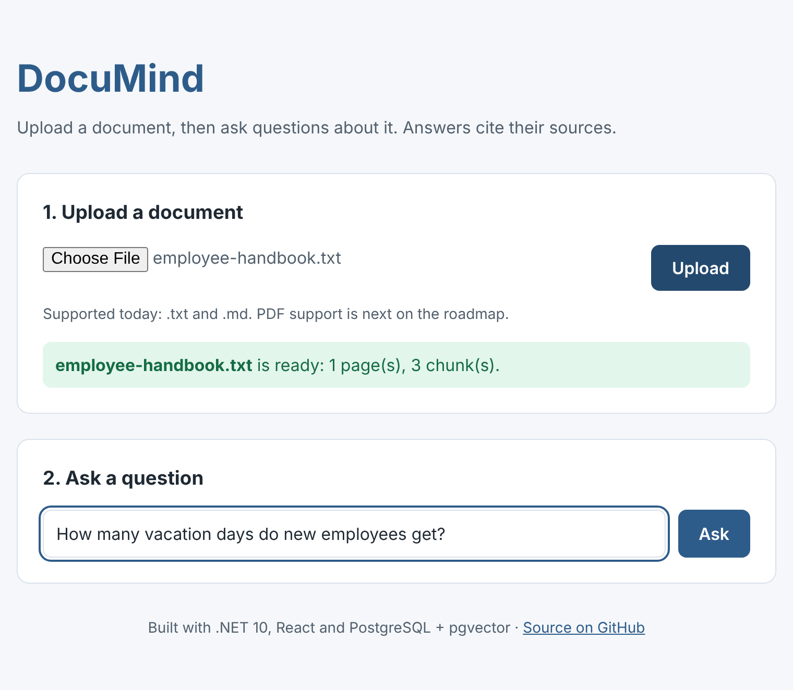
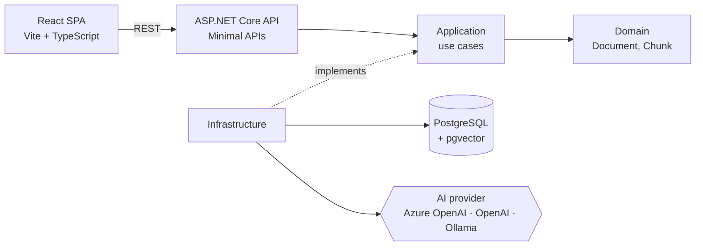
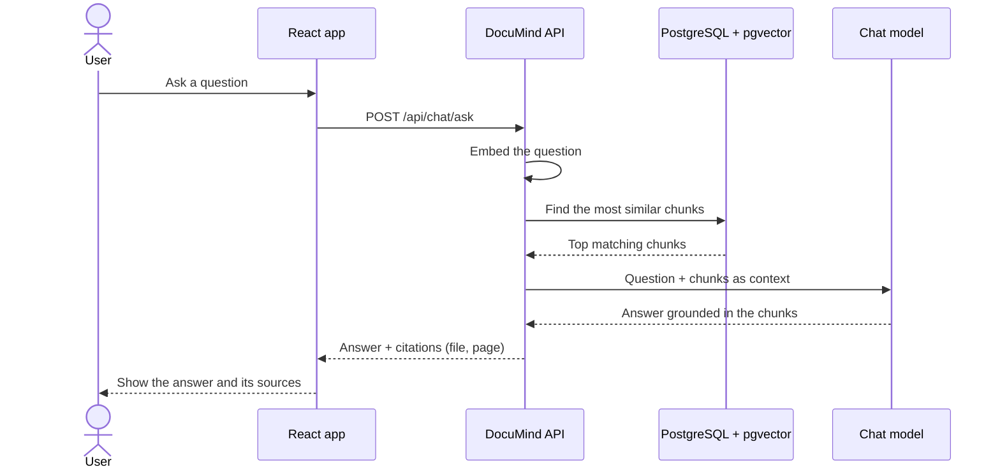

<div align="center">


# DocuMind

**Ask questions about your documents and get answers that cite their sources.**

An open-source RAG (retrieval-augmented generation) app built with .NET 10, React and PostgreSQL + pgvector.

[](https://github.com/developersalaria/documind/actions/workflows/ci.yml)


[](LICENSE)

</div>

> **Status: early development.** Uploading and chunking work today. Embeddings, search and answers are next; see the [roadmap](docs/ROADMAP.md).



## Why DocuMind?

Many RAG examples are quick Python notebooks. DocuMind shows how to build one the way production .NET teams do: clean architecture, swappable AI providers, automated tests, CI and containers.

## Features

- Upload documents (`.txt` and `.md` today, PDF next)
- Text extraction and chunking with overlap that breaks at sentence ends, never mid-word
- Embeddings stored in PostgreSQL with pgvector *(planned)*
- Semantic search and grounded answers with page citations *(planned)*
- Works with Azure OpenAI, OpenAI, or free local models through Ollama *(planned)*
- React chat UI with streaming answers *(planned)*

## Architecture



| Project | Responsibility |
|---|---|
| `DocuMind.Domain` | Entities and rules: `Document`, `DocumentChunk`. No dependencies. |
| `DocuMind.Application` | Use cases such as ingestion and chunking, plus interfaces like `ITextExtractor`. |
| `DocuMind.Infrastructure` | Implementations: text extraction, database (EF Core + pgvector), AI providers. |
| `DocuMind.Api` | HTTP endpoints, validation, ProblemDetails errors and OpenAPI. |
| `web` | React front-end. |

### How a question gets answered



## Tech stack

| Area | Tools |
|---|---|
| Backend | .NET 10, ASP.NET Core Minimal APIs, OpenAPI, ProblemDetails |
| AI *(planned)* | Microsoft.Extensions.AI with Azure OpenAI, OpenAI or Ollama |
| Data *(planned)* | PostgreSQL, pgvector, EF Core |
| Frontend | React 19, TypeScript, Vite |
| Quality | xUnit, GitHub Actions, Dependabot, central package management, warnings as errors |
| Local development | Docker Compose |

## Getting started

### Prerequisites

- [.NET 10 SDK](https://dotnet.microsoft.com/download)
- [Node.js 22+](https://nodejs.org/)
- [Docker](https://www.docker.com/) for PostgreSQL and, optionally, Ollama

### Run it

```bash
git clone https://github.com/developersalaria/documind.git
cd documind

# 1. Start PostgreSQL + pgvector (add --profile ollama to also run local AI models)
docker compose up -d

# 2. Run the API on http://localhost:5080
dotnet run --project src/DocuMind.Api

# 3. In a second terminal, run the web app on http://localhost:5173
cd web
npm install
npm run dev
```

Open http://localhost:5173 and upload a `.txt` or `.md` file to see how it is chunked. The OpenAPI document is at http://localhost:5080/openapi/v1.json, and `src/DocuMind.Api/DocuMind.Api.http` has ready-made requests for Visual Studio, VS Code and Rider.

### Run the tests

```bash
dotnet test
```

## Configuration

Settings live in `src/DocuMind.Api/appsettings.json`. Keep API keys out of source control with [user secrets](https://learn.microsoft.com/aspnet/core/security/app-secrets):

```bash
dotnet user-secrets set "AI:ApiKey" "<your-key>" --project src/DocuMind.Api
```

| Setting | Description | Default |
|---|---|---|
| `AI:Provider` | `Ollama`, `AzureOpenAI` or `OpenAI` | `Ollama` |
| `AI:Endpoint` | Ollama or Azure OpenAI endpoint | `http://localhost:11434` |
| `AI:ChatModel` | Chat model or deployment name | `llama3.2` |
| `AI:EmbeddingModel` | Embedding model or deployment name | `nomic-embed-text` |
| `AI:ApiKey` | Key for Azure OpenAI or OpenAI (user secrets only) | none |
| `Chunking:ChunkSize` | Maximum characters per chunk | `1000` |
| `Chunking:Overlap` | Characters shared by neighboring chunks | `150` |
| `ConnectionStrings:Postgres` | PostgreSQL connection string | set in `appsettings.Development.json` |

## Project structure

```text
documind/
├── src/
│   ├── DocuMind.Api/              # Minimal API endpoints, configuration, OpenAPI
│   ├── DocuMind.Application/      # Use cases, chunking, interfaces
│   ├── DocuMind.Domain/           # Entities
│   └── DocuMind.Infrastructure/   # Text extraction, database, AI providers
├── tests/
│   └── DocuMind.UnitTests/        # xUnit tests
├── web/                           # React + TypeScript + Vite
├── docs/                          # Roadmap and images
├── docker-compose.yml             # PostgreSQL + pgvector, optional Ollama
└── .github/                       # CI, Dependabot, issue and PR templates
```

## Roadmap

The full plan, with implementation notes for each step, is in [docs/ROADMAP.md](docs/ROADMAP.md).

- [x] Solution structure, CI and Docker Compose
- [x] Upload `.txt` and `.md` files and split them into chunks
- [ ] PDF support
- [ ] Embeddings stored in PostgreSQL + pgvector
- [ ] Semantic search
- [ ] Grounded answers with citations
- [ ] Streaming chat UI
- [ ] Integration tests with Testcontainers
- [ ] Deploy to Azure with a live demo
- [ ] Sign-in with Microsoft Entra ID

## Contributing

Contributions are welcome. Please read [CONTRIBUTING.md](CONTRIBUTING.md) first.

## License

[MIT](LICENSE) © Pardeep Salaria
